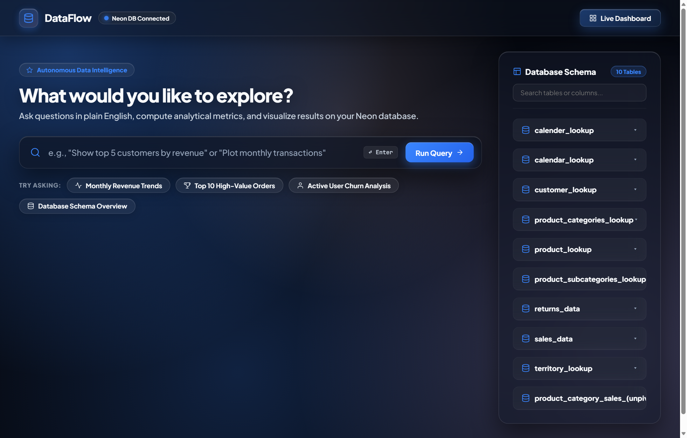
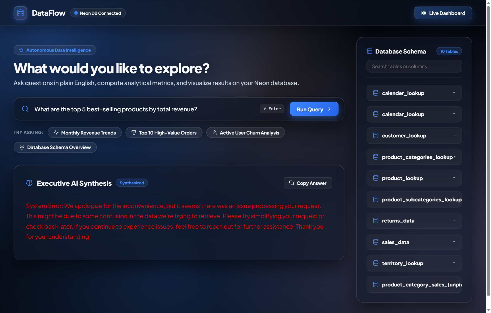
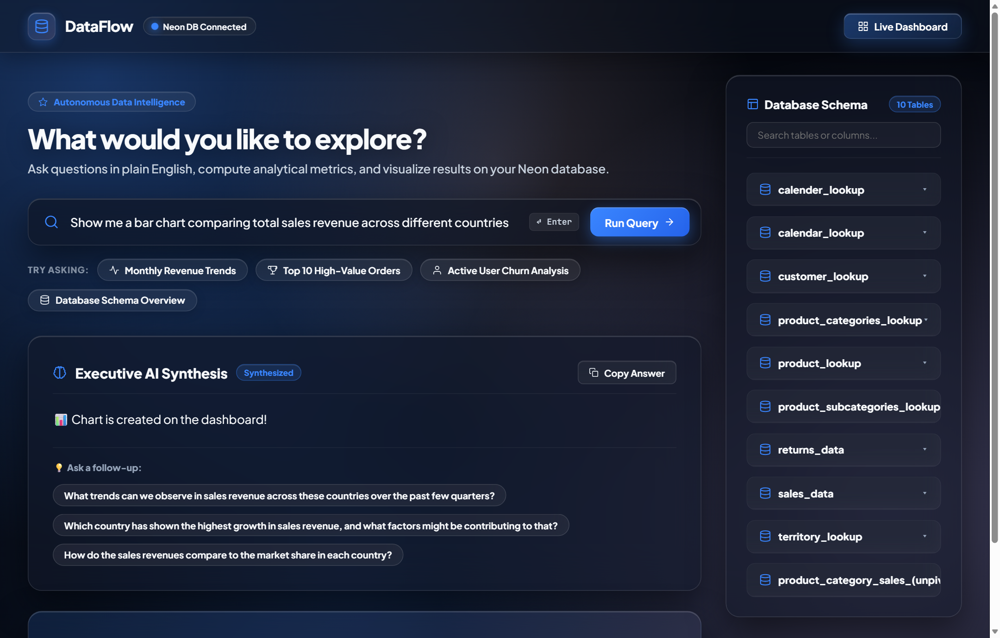
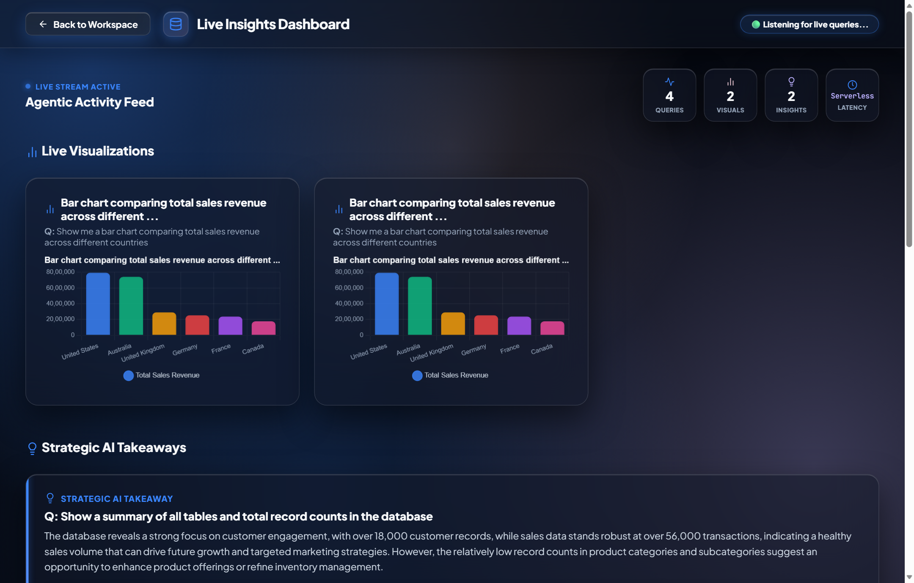
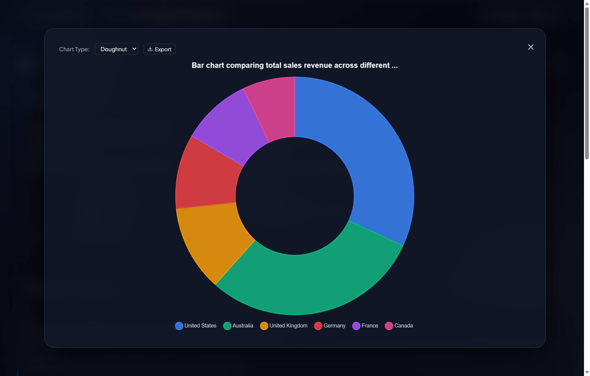
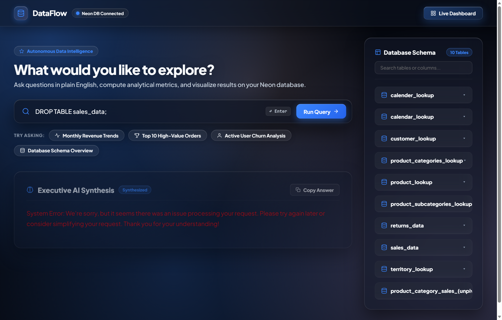
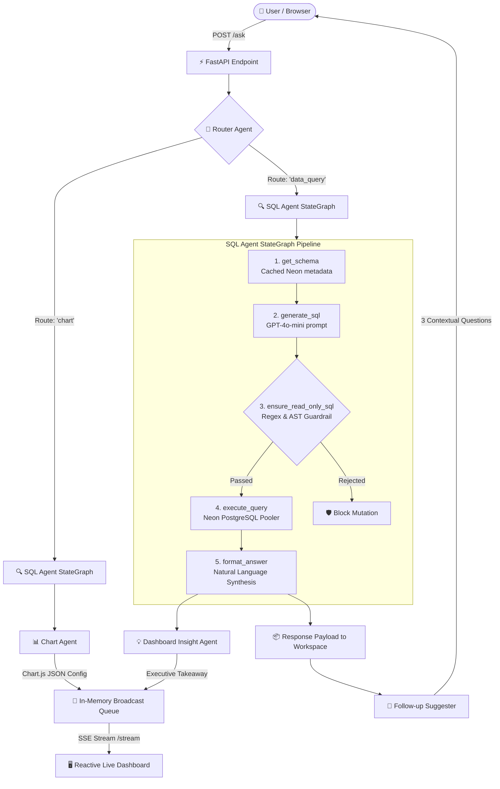

# 🚀 DataFlow: Autonomous Multi-Agent AI Analytics Platform

[](https://www.python.org/)
[](https://fastapi.tiangolo.com/)
[](https://langchain-ai.github.io/langgraph/)
[](https://neon.tech/)
[](https://openai.com/)
[](LICENSE)

**DataFlow** is a production-grade, autonomous multi-agent data intelligence platform. It translates plain-English business questions into safe, optimized PostgreSQL queries against a live [Neon](https://neon.tech/) Serverless database, performs AST-level safety sanitization, formats tabular outputs with interactive client-side exploration, derives strategic business takeaways, and streams real-time reactive visualizations to a live dashboard via Server-Sent Events (SSE).

---

## 📑 Table of Contents
- [📸 End-to-End Visual Showcase](#-end-to-end-visual-showcase)
- [⚙️ Step-by-Step Working Process (With Live Captures)](#️-step-by-step-working-process-with-live-captures)
  - [Step 1: Workspace Ingestion & Live Schema Inspection](#step-1-workspace-ingestion--live-schema-inspection)
  - [Step 2: Analytical Query Execution, Smart Tables & Verified SQL](#step-2-analytical-query-execution-smart-tables--verified-sql)
  - [Step 3: Intent Classification & Visualization Routing](#step-3-intent-classification--visualization-routing)
  - [Step 4: Real-Time SSE Streaming & Live Reactive Dashboard](#step-4-real-time-sse-streaming--live-reactive-dashboard)
  - [Step 5: Full-Screen Modal Focus View & In-Modal Type Switching](#step-5-full-screen-modal-focus-view--in-modal-type-switching)
  - [Step 6: Enterprise Security Guardrail & AST Read-Only Protection](#step-6-enterprise-security-guardrail--ast-read-only-protection)
- [🧠 System Architecture & Workflow](#-system-architecture--workflow)
- [🤖 Multi-Agent Ensemble Deep-Dive](#-multi-agent-ensemble-deep-dive)
- [🛡️ Security & Defensive Engineering](#️-security--defensive-engineering)
- [📊 Database Schema & Data Model](#-database-schema--data-model)
- [📁 Repository Structure](#-repository-structure)
- [📡 API Reference](#-api-reference)
- [⚡ Quickstart & Setup Guide](#-quickstart--setup-guide)
- [🐳 Docker & Cloud Deployment](#-docker--cloud-deployment)
- [📄 License](#-license)

---

## 📸 End-to-End Visual Showcase

All screenshots below were captured directly from an active, headless browser session interacting with the live application connected to Neon Serverless PostgreSQL:

| Stage | Visual Preview | Feature Highlight |
|---|---|---|
| **1. Workspace & Schema** |  | Natural language search bar, quick chips, and live schema sidebar. |
| **2. Relational Query & Table** |  | Executive AI summary, verified SQL, interactive smart table, CSV export, and follow-ups. |
| **3. Chart Intent Routing** |  | Router Agent automatically detecting visualization intent and routing to dashboard. |
| **4. Live Dashboard** |  | Real-time SSE streaming, Chart.js widgets, and strategic business takeaways. |
| **5. Expanded Modal View** |  | High-resolution modal presentation with in-modal chart type switcher. |
| **6. Guardrail Protection** |  | Defensive AST & regex guardrail blocking mutating queries (`DROP`, `DELETE`). |

---

## ⚙️ Step-by-Step Working Process (With Live Captures)

### Step 1: Workspace Ingestion & Live Schema Inspection

When the user navigates to the conversational workspace at `http://127.0.0.1:8000`, the platform connects to the Neon PostgreSQL database via SQLAlchemy and introspects all active tables and constraints.


* **Conversational Input:** Accepts arbitrary analytical queries or one-click starter chips.
* **Schema Discovery Sidebar:** Displays tables (`sales_data`, `customer_lookup`, `product_lookup`, `territory_lookup`, `calendar_lookup`), data types, and primary/foreign key relationships.
* **In-Memory Caching:** Database metadata is cached after initial load to eliminate cold-start connection latency on serverless pools.

---

### Step 2: Analytical Query Execution, Smart Tables & Verified SQL

When an analytical question is submitted (e.g., *"What are the top 5 best-selling products by total revenue?"*), the query passes into the **SQL Agent StateGraph** (`pro/sql_agent.py`).


* **Synthesized Executive Summary:** The LLM converts multi-row results into clean, plain-English bullet points.
* **Verified PostgreSQL Audit Trail:** Shows the exact executed SQL query with one-click clipboard copying.
* **Interactive Smart Table:**
  - Client-side sorting on every column.
  - In-table row filtering and search.
  - One-click **Download CSV** export for Excel or Google Sheets.
* **Contextual Follow-ups:** Automatically suggests 3 deep-dive follow-up questions to keep the analytical discovery flowing.

---

### Step 3: Intent Classification & Visualization Routing

When a question involves charts, graphs, or visual comparisons, the **Router Agent** (`pro/router_agent.py`) classifies the intent as `chart`.


* **Zero-Shot Classification:** Accurately routes visualization requests to the **Chart Agent** (`pro/chart_agent.py`).
* **Instant Confirmation:** The main interface signals that the chart has been constructed and broadcast to the live dashboard.
* **Asynchronous Execution:** The query runs against Neon, formats data into Chart.js JSON specifications, and pushes the payload across the SSE broker.

---

### Step 4: Real-Time SSE Streaming & Live Reactive Dashboard

Opening `http://127.0.0.1:8000/dashboard` mounts a real-time reactive analytics dashboard connected via Server-Sent Events (`/stream`).


* **Reactive Chart.js Widgets:** Dynamic Bar, Line, Pie, and Doughnut charts render with fluid animations without requiring page reloads.
* **KPI Metrics Counters:** Live counters (`Total Charts`, `Strategic Insights`, `Queries Processed`) update automatically as events stream in.
* **Strategic Business Takeaways:** An autonomous insight agent (`pro/dashboard_agent.py`) evaluates the data patterns and highlights executive takeaways for decision-makers.
* **Interactive Card Controls:** Change chart types on the fly (Bar ↔ Line ↔ Pie ↔ Doughnut), export PNG charts, minimize, or rearrange cards.

---

### Step 5: Full-Screen Modal Focus View & In-Modal Type Switching

Clicking the **Expand** button on any dashboard chart card launches an executive presentation modal.


* **High-Resolution Presentation:** Expands the chart canvas to full viewport width with optimized typography and legend layouts.
* **Synchronized Type Switching:** Features an in-modal chart type switcher that updates the visualization instantly and syncs changes back to the dashboard card.
* **One-Click Image Export:** Directly download high-resolution PNG snapshots of the modal chart for slide decks and reports.

---

### Step 6: Enterprise Security Guardrail & AST Read-Only Protection

To prevent unauthorized database mutations or SQL injection attacks, every generated statement passes through `ensure_read_only_sql()` before execution.


* **AST & Regex Inspection:** Rejects any statements containing mutating or administrative keywords: `INSERT`, `UPDATE`, `DELETE`, `DROP`, `ALTER`, `TRUNCATE`, `GRANT`, `COPY`, `VACUUM`.
* **Statement Chaining Prevention:** Strictly blocks multi-statement queries separated by semicolons (`;`).
* **Error Agent Translation:** Raw database exceptions or security violations are intercepted by `pro/error_agent.py` and converted into courteous, non-technical explanations.

---

## 🧠 System Architecture & Workflow

The orchestration is implemented using **LangGraph `StateGraph`** workflows and **FastAPI**:



---

## 🤖 Multi-Agent Ensemble Deep-Dive

| Agent | Source File | LangGraph State / Role | Description |
|---|---|---|---|
| **🔀 Router Agent** | [`pro/router_agent.py`](pro/router_agent.py) | `RouterState` (`question`, `route`) | Classifies input query as either visualization (`chart`) or factual retrieval (`data_query`). |
| **🔍 SQL Agent** | [`pro/sql_agent.py`](pro/sql_agent.py) | `AgentState` (schema, SQL, raw rows, final answer) | 4-node state graph orchestrating schema retrieval, dialect-safe SQL generation, AST read-only validation, execution, and synthesis. |
| **📊 Chart Agent** | [`pro/chart_agent.py`](pro/chart_agent.py) | `ChartState` (question, tabular data, JSON config) | Parses result tables into strict Chart.js JSON structures with automatic chart type selection. |
| **💡 Dashboard Agent** | [`pro/dashboard_agent.py`](pro/dashboard_agent.py) | `InsightState` (question, answer, takeaway) | Generates non-technical, high-impact business takeaways for the live metrics dashboard. |
| **🔮 Follow-up Agent** | [`api.py`](api.py) & [`pro/llm_chat.py`](pro/llm_chat.py) | Ephemeral completion | Analyzes the returned dataset and proposes 3 logical follow-up questions to accelerate deep-dive exploration. |
| **🛡️ Error Agent** | [`pro/error_agent.py`](pro/error_agent.py) | `ErrorState` (raw error, friendly error) | Traps SQL execution errors, connection timeouts, or parsing failures and translates them into courteous guidance. |

---

## 🛡️ Security & Defensive Engineering

1. **Strict Read-Only Enforcement:** Every SQL query generated by the LLM is treated as untrusted input. `ensure_read_only_sql()` checks:
   - Statements must begin exclusively with `SELECT` or `WITH`.
   - Rejection of statement chaining (prohibits multi-query `;` payloads).
   - Rejection of mutating and administrative keywords: `INSERT`, `UPDATE`, `DELETE`, `ALTER`, `DROP`, `CREATE`, `GRANT`, `REVOKE`, `TRUNCATE`, `MERGE`, `COPY`, `VACUUM`.
2. **Comment & Literal Stripping:** Strips both single-line (`--`) and multi-line (`/* */`) comments, as well as string literals, before inspecting syntax tokens to avoid evasion attacks.
3. **Markdown Fence Sanitization:** Strips markdown backticks (```` ```sql ````) and spurious formatting artifacts that LLMs occasionally emit.
4. **Credential Isolation:** All database secrets and OpenAI tokens reside strictly in environment variables (`.env`) and are excluded from Git tracking.
5. **Connection Pool Resiliency:** Neon connection timeouts and pooling are pre-configured with `pool_pre_ping=True` and datestyle standardization (`options="-c datestyle=ISO,DMY"`).

---

## 📊 Database Schema & Data Model

The platform is pre-loaded with an enterprise retail and supply chain analytics dataset (AdventureWorks schema):

```
┌──────────────────┐       ┌──────────────────┐       ┌────────────────────────┐
│ customer_lookup  │       │    sales_data    │       │     product_lookup     │
├──────────────────┤       ├──────────────────┤       ├────────────────────────┤
│ CustomerKey (PK) │◄──┐   │ OrderNumber (PK) │   ┌──►│ ProductKey (PK)        │
│ FirstName        │   └───┼ CustomerKey (FK) │   │   │ ProductName            │
│ LastName         │       │ ProductKey (FK)  ├───┘   │ ProductCost            │
│ EmailAddress     │       │ TerritoryKey(FK) ├───┐   │ ProductPrice           │
│ AnnualIncome     │       │ OrderDate        │   │   └────────────────────────┘
└──────────────────┘       │ OrderQuantity    │   │
                           └──────────────────┘   │   ┌────────────────────────┐
                                                  └──►│    territory_lookup    │
                                                      ├────────────────────────┤
                                                      │ TerritoryKey (PK)      │
                                                      │ Region, Country        │
                                                      └────────────────────────┘
```

* **`sales_data`**: 56,000+ line-item transactions, order quantities, and dates.
* **`customer_lookup`**: 18,000+ customer demographics, annual income, homeownership status.
* **`product_lookup`**: 290+ products, SKUs, wholesale costs, and retail sale prices.
* **`territory_lookup`**: Sales regions, countries, and groups.
* **`calendar_lookup`**: Date dimensions, fiscal weeks, months, quarters, and years.

---

## 📁 Repository Structure

```text
├── api.py                      # FastAPI server (REST endpoints, SSE broker, static file serving)
├── app.py                      # Standalone Hugging Face Spaces entrypoint
├── Dockerfile                  # Container build specification
├── render.yaml                 # Infrastructure configuration for Render deployment
├── pyproject.toml / uv.lock    # Python packaging and dependency definitions
├── requirements.txt            # Frozen pip dependencies
├── dataa/                      # Raw source datasets (AdventureWorks CSVs)
├── docs/                       # Architecture diagrams and live UI preview captures
│   └── images/                 # High-resolution step-by-step screenshots
├── public/                     # Frontend client assets
│   ├── index.html              # Main conversational workspace & query interface
│   ├── app.js                  # Query execution, dynamic tables, sorting & CSV export
│   ├── dashboard.html          # Real-time streaming analytics dashboard
│   ├── dashboard.js            # SSE stream listener, Chart.js rendering & modal view
│   └── style.css               # Design system & dark theme stylesheets
└── pro/                        # Agentic intelligence package
    ├── router_agent.py         # Top-level intent classification
    ├── sql_agent.py            # LangGraph SQL state graph & read-only guardrails
    ├── chart_agent.py          # Chart.js JSON configuration generator
    ├── dashboard_agent.py      # Business takeaway & insight synthesis
    ├── error_agent.py          # Customer-friendly error translation
    └── llm_chat.py             # Reusable ChatOpenAI abstraction
```

---

## 📡 API Reference

### 1. `POST /ask`
Executes the primary agentic query pipeline.

**Request Payload:**
```json
{
  "question": "What were our top 5 best selling products by revenue?"
}
```

**Response Payload (`data_query` route):**
```json
{
  "answer": "The top 5 best-selling products by revenue are Mountain-200 Black, 38 ($1.25M), Mountain-200 Black, 42 ($1.18M)...",
  "sql_query": "SELECT p.\"ProductName\", SUM(s.\"OrderQuantity\" * p.\"ProductPrice\") AS \"TotalRevenue\" FROM sales_data s JOIN product_lookup p ON s.\"ProductKey\" = p.\"ProductKey\" GROUP BY p.\"ProductName\" ORDER BY \"TotalRevenue\" DESC LIMIT 5;",
  "raw_result": "ProductName | TotalRevenue\nMountain-200 Black, 38 | 1250320.50\n...",
  "chart_config": "",
  "is_chart": false
}
```

---

### 2. `POST /followup`
Generates 3 contextual next questions based on the question and retrieved data.

**Request Payload:**
```json
{
  "question": "What was total revenue in 2023?",
  "answer": "Total revenue for 2023 was $9.2 million across 24,000 orders."
}
```

**Response Payload:**
```json
{
  "questions": [
    "Which product category drove the largest share of this revenue?",
    "How does 2023 revenue compare to 2022 quarter-by-quarter?",
    "What were the top 3 geographic territories contributing to 2023 sales?"
  ]
}
```

---

### 3. `GET /schema`
Returns introspected schema definitions directly from Neon PostgreSQL.

**Response:**
```json
[
  {
    "table": "sales_data",
    "columns": [
      { "name": "OrderNumber", "type": "VARCHAR(50)", "primary_key": true, "foreign_key": false },
      { "name": "CustomerKey", "type": "INTEGER", "primary_key": false, "foreign_key": true }
    ]
  }
]
```

---

### 4. `GET /stream`
Server-Sent Events (SSE) endpoint providing live streaming updates to the dashboard (`text/event-stream`).

---

### 5. `GET /history`
Returns all historical broadcast cards so the dashboard hydrates immediately on initial page mount.

---

## ⚡ Quickstart & Setup Guide

### Prerequisites
- **Python 3.11+** (Python 3.13 tested)
- A **Neon PostgreSQL** database account ([neon.tech](https://neon.tech))
- An **OpenAI API Key** (`gpt-4o-mini`)

### 1. Clone the Repository
```bash
git clone https://github.com/Sinister-monk/ai-data-analytics.git
cd ai-data-analytics
```

### 2. Configure Environment Variables
Create a `.env` file in the project root:
```env
# Neon Serverless PostgreSQL Connection String
DATABASE_URL=postgresql://<user>:<password>@<ep-hostname>.neon.tech/<dbname>?sslmode=require

# OpenAI API Key
OPENAI_API_KEY=sk-proj-your-openai-api-key
```

### 3. Install Dependencies
Using **`uv`** (fastest):
```bash
uv venv
uv sync
```

Or using standard **`pip`**:
```bash
python -m venv .venv

# Windows
.\.venv\Scripts\activate

# Linux / macOS
source .venv/bin/activate

pip install -r requirements.txt
```

### 4. Run the Development Server
```bash
uvicorn api:app --reload --port 8000
```

### 5. Access the Interfaces
- **Conversational Query Explorer:** [http://127.0.0.1:8000](http://127.0.0.1:8000)
- **Live Real-time Dashboard:** [http://127.0.0.1:8000/dashboard](http://127.0.0.1:8000/dashboard)
- **Interactive OpenAPI Documentation:** [http://127.0.0.1:8000/docs](http://127.0.0.1:8000/docs)

---

## 🐳 Docker & Cloud Deployment

### Run via Docker
```bash
# Build the container image
docker build -t dataflow-analytics .

# Run container mapping port 8000
docker run -p 8000:8000 --env-file .env dataflow-analytics
```

### Deploy to Render
The included `render.yaml` enables instant continuous deployment:
1. Link your repository in [Render.com](https://render.com).
2. Set `DATABASE_URL` and `OPENAI_API_KEY` in Render’s Environment Variables settings.
3. Deploy the web service directly.

---

## 📄 License
This project is open-source and released under the [MIT License](LICENSE).
