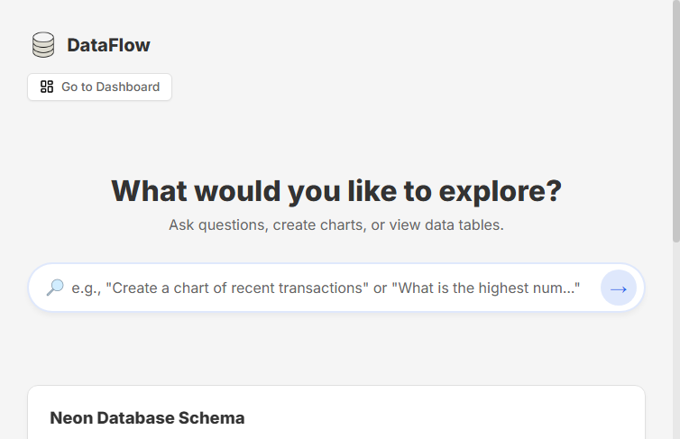
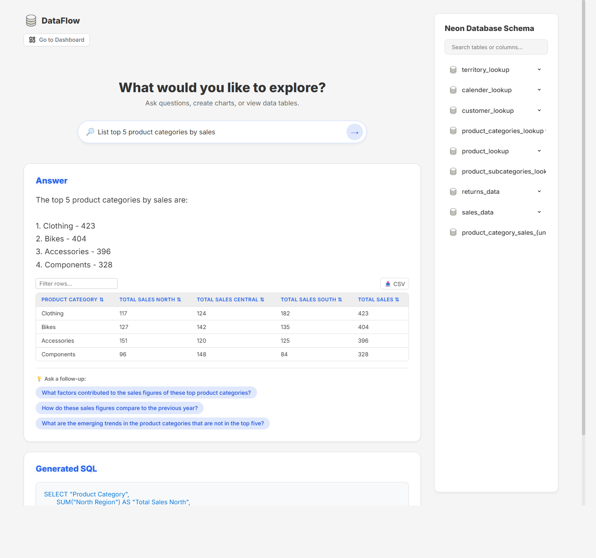
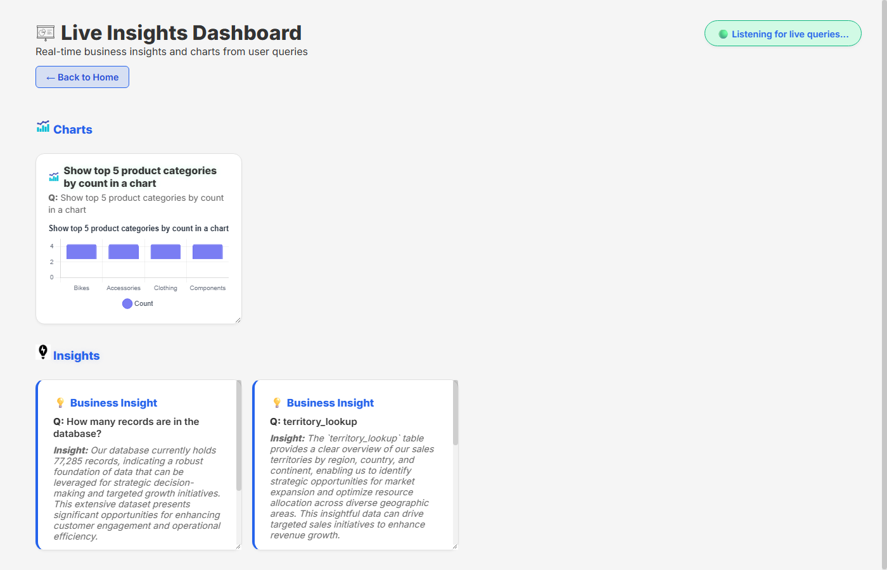

# 🚀 DataFlow: Autonomous Multi-Agent AI Analytics Platform

[](https://www.python.org/)
[](https://fastapi.tiangolo.com/)
[](https://langchain-ai.github.io/langgraph/)
[](https://neon.tech/)
[](https://openai.com/)
[](LICENSE)

**DataFlow** is a production-grade, autonomous multi-agent data intelligence platform. It translates plain-English business questions into safe, optimized PostgreSQL queries against a live [Neon](https://neon.tech/) Serverless database, performs AST-level safety sanitization, formats tabular outputs with interactive client-side exploration, derives high-level business takeaways, and streams real-time reactive visualizations to a live dashboard via Server-Sent Events (SSE).

---

## 📑 Table of Contents
- [📸 Visual Showcase](#-visual-showcase)
- [⚙️ How It Works: Complete Working Procedure](#️-how-it-works-complete-working-procedure)
  - [Phase 1: Ingestion & Intent Routing](#phase-1-ingestion--intent-routing)
  - [Phase 2: Schema Introspection & Caching](#phase-2-schema-introspection--caching)
  - [Phase 3: SQL Synthesis & Safety Guardrails](#phase-3-sql-synthesis--safety-guardrails)
  - [Phase 4: Database Execution & Result Processing](#phase-4-database-execution--result-processing)
  - [Phase 5: Answer Synthesis & Dual-Channel Dispatch](#phase-5-answer-synthesis--dual-channel-dispatch)
  - [Phase 6: Real-Time SSE Streaming & Reactive Dashboard](#phase-6-real-time-sse-streaming--reactive-dashboard)
- [🧠 System Architecture & Workflow](#-system-architecture--workflow)
- [🤖 Multi-Agent Ensemble Deep-Dive](#-multi-agent-ensemble-deep-dive)
- [🛡️ Security, Guardrails & Defensive Engineering](#️-security-guardrails--defensive-engineering)
- [📊 Database Schema & Data Model](#-database-schema--data-model)
- [📁 Repository Structure](#-repository-structure)
- [📡 API Reference](#-api-reference)
- [⚡ Quickstart & Setup Guide](#-quickstart--setup-guide)
- [🐳 Docker & Cloud Deployment](#-docker--cloud-deployment)
- [📄 License](#-license)

---

## 📸 Visual Showcase

### 1. Natural Language Data Explorer & Live Schema Inspector
Type arbitrary business inquiries in natural language or choose quick exploration chips. The collapsible inspector queries Neon's information schema in real time to reveal tables, primary keys, and foreign keys.



* **Zero-Latency Metadata:** Table schema is introspected directly from Neon PostgreSQL and cached in memory.
* **Proactive Starters:** One-click chips allow instant exploration of revenue patterns, customer cohorts, and database table summaries.

---

### 2. Intelligent Query Execution, Smart Tables & Verified SQL
DataFlow generates and verifies standard ANSI PostgreSQL queries, renders interactive tables, and drafts automated follow-up prompts.



* **Executive Synthesis:** Translates dense multi-column tabular outputs into concise executive bullet points.
* **Interactive Smart Table:** Offers instantaneous client-side sorting, column filtering, and one-click **CSV download**.
* **Audit Transparency:** Shows the exact executed SQL query with one-click clipboard copying.
* **Proactive Follow-ups:** Evaluates results to suggest 3 logical next questions to continue the investigation.

---

### 3. Real-Time Streaming Insights & Reactive Dashboard
Metrics and chart configurations stream live over Server-Sent Events (SSE) into a separate, dynamic dashboard view without page refreshing.



* **Dynamic Chart.js Widgets:** Metric-driven requests automatically construct responsive Bar, Line, Pie, and Doughnut charts.
* **Autonomous Business Takeaways:** AI agents analyze data patterns and highlight strategic business insights for leadership.
* **Modal Focus View & Layout Persistence:** Expand widgets into full-screen viewports; card preferences persist in `localStorage`.

---

## ⚙️ How It Works: Complete Working Procedure

The lifecycle of an inquiry spans six distinct pipeline phases:

```
[User Prompt]
      │
      ▼
┌───────────────────────────┐
│ Phase 1: Intent Routing   │ ──► Classify: 'data_query' vs. 'chart'
└─────────────┬─────────────┘
              │
              ▼
┌───────────────────────────┐
│ Phase 2: Schema Discovery │ ──► Load cached Neon schema metadata
└─────────────┬─────────────┘
              │
              ▼
┌───────────────────────────┐
│ Phase 3: SQL & Guardrails │ ──► LLM generates SQL ──► Strict AST & Regex Validator
└─────────────┬─────────────┘
              │
              ▼
┌───────────────────────────┐
│ Phase 4: Database Dispatch│ ──► Execute read-only SQL via Neon connection pool
└─────────────┬─────────────┘
              │
              ▼
┌───────────────────────────┐
│ Phase 5: Synthesis        │ ──► Generate Executive Answer & Business Takeaway
└─────────────┬─────────────┘
              │
              ▼
┌───────────────────────────┐
│ Phase 6: Dual Dispatch    │ ──► Return REST response to Client + Push to SSE Stream
└───────────────────────────┘
```

---

### Phase 1: Ingestion & Intent Routing
1. The user enters a question into the web interface or sends a `POST` request to `/ask`.
2. The payload is validated with **Pydantic** (`QueryRequest`), verifying length and stripping malicious whitespace.
3. The request enters the **Router Agent** (`pro/router_agent.py`), which uses zero-shot structured classification to categorize user intent:
   - **`data_query`**: Fact-finding, record lookups, aggregations, counts, top-N reports.
   - **`chart`**: Explicit or implied visualizations (e.g., *"bar chart of monthly revenue"*, *"plot orders over time"*).

---

### Phase 2: Schema Introspection & Caching
1. The query workflow enters the **SQL Agent StateGraph** (`pro/sql_agent.py`).
2. The `get_schema` node inspects the connected **Neon PostgreSQL** database.
3. To eliminate redundant network trips and latency on serverless connections, metadata (table definitions, primary keys, relationships, datatypes) is cached in-memory (`_cached_table_info`).

---

### Phase 3: SQL Synthesis & Safety Guardrails
1. The `generate_sql` node constructs a comprehensive prompt containing:
   - Cached database schema.
   - Strict dialect rules (PostgreSQL timestamp functions like `DATE_TRUNC`, standard `YYYY-MM-DD` ISO formatting, double quotes for uppercase columns).
   - User inquiry.
2. The model synthesizes an ANSI PostgreSQL query.
3. **Safety Guardrail (`ensure_read_only_sql`):** Before reaching the database, the generated SQL passes through rigorous inspection:
   - Strips code fences (```` ```sql ````) and normalizes formatting.
   - Strips SQL inline and block comments (`--`, `/* ... */`) and string literals.
   - Verifies that only a **single** statement exists (prohibits multi-statement query chaining with `;`).
   - Verifies the statement strictly begins with `SELECT` or `WITH`.
   - Rejects any mutating or administrative operations (`INSERT`, `UPDATE`, `DELETE`, `DROP`, `ALTER`, `TRUNCATE`, `GRANT`, `COPY`, `VACUUM`).

---

### Phase 4: Database Execution & Result Processing
1. The sanitized query is dispatched through **SQLAlchemy** via Neon’s connection pooler with session options:
   ```python
   connect_args={"connect_timeout": 10, "options": "-c datestyle=ISO,DMY"}
   ```
2. Rows are extracted, mapped against column headers, and serialized into pipe-delimited tabular strings for optimal downstream LLM comprehension.
3. If a runtime database error occurs, control shifts to the **Error Agent** (`pro/error_agent.py`), which converts raw SQL stack traces into user-friendly, actionable feedback without revealing internal table names or credentials.

---

### Phase 5: Answer Synthesis & Dual-Channel Dispatch
1. The `format_answer` node synthesizes the tabular data into concise, natural-language executive bullet points.
2. If the request was classified as a **`data_query`**:
   - The **Dashboard Agent** (`pro/dashboard_agent.py`) computes a high-level strategic takeaway suitable for executive stakeholders.
   - The primary response (Answer, Verified SQL, Raw Data) is returned to the user workspace.
   - An asynchronous task triggers the **Follow-up Suggester** (`/followup`) to predict three high-value follow-up questions.
3. If the request was classified as a **`chart`**:
   - The **Chart Agent** (`pro/chart_agent.py`) evaluates the dataset and generates a valid, typed **Chart.js** configuration object (Bar, Line, Pie, or Doughnut).

---

### Phase 6: Real-Time SSE Streaming & Reactive Dashboard
1. Any newly minted business insight or chart configuration is serialized and broadcast across an active asynchronous `asyncio.Queue` listener pool (`/stream`).
2. Connected clients on `/dashboard` receive the Server-Sent Event (SSE) payload instantly without polling or refreshing.
3. All broadcast payloads are preserved in an in-memory `history` store, allowing newly opened dashboard tabs to hydrate immediately upon mounting (`/history`).

---

## 🧠 System Architecture & Workflow

The orchestration is implemented using **LangGraph `StateGraph`** workflows and **FastAPI**:


---

## 🤖 Multi-Agent Ensemble Deep-Dive

| Agent | Source File | LangGraph State / Role | Description |
|---|---|---|---|
| **🔀 Router Agent** | [`pro/router_agent.py`](pro/router_agent.py) | `RouterState` (`question`, `route`) | Classifies input query as either visualization (`chart`) or factual retrieval (`data_query`). |
| **🔍 SQL Agent** | [`pro/sql_agent.py`](pro/sql_agent.py) | `AgentState` (schema, SQL, raw rows, final answer) | 4-node state graph orchestrating schema retrieval, dialect-safe SQL generation, AST read-only validation, execution, and synthesis. |
| **📊 Chart Agent** | [`pro/chart_agent.py`](pro/chart_agent.py) | `ChartState` (question, tabular data, JSON config) | Parses result tables into strict Chart.js JSON structures with automatic chart type selection. |
| **💡 Dashboard Agent** | [`pro/dashboard_agent.py`](pro/dashboard_agent.py) | `InsightState` (question, answer, takeaway) | Generates non-technical, high-impact business takeaways for the live metrics dashboard. |
| **🔮 Follow-up Agent** | [`api.py`](api.py) & [`pro/llm_chat.py`](pro/llm_chat.py) | Ephemeral completion | Analyzes the returned dataset and proposes 3 logical follow-up questions to accelerate deep-dive exploration. |
| **🛡️ Error Agent** | [`pro/error_agent.py`](pro/error_agent.py) | `ErrorState` (raw error, friendly error) | Traps SQL execution errors, connection timeouts, or parsing failures and translates them into courteous guidance. |

---

## 🛡️ Security, Guardrails & Defensive Engineering

1. **Strict Read-Only Enforcement:** Every SQL query generated by the LLM is treated as untrusted input. `ensure_read_only_sql()` checks:
   - Statements must begin exclusively with `SELECT` or `WITH`.
   - Rejection of statement chaining (prohibits multi-query `;` payloads).
   - Rejection of mutating and administrative keywords: `INSERT`, `UPDATE`, `DELETE`, `ALTER`, `DROP`, `CREATE`, `GRANT`, `REVOKE`, `TRUNCATE`, `MERGE`, `COPY`, `VACUUM`.
2. **Comment & Literal Stripping:** Strips both single-line (`--`) and multi-line (`/* */`) comments, as well as string literals, before inspecting syntax tokens to avoid evasion attacks.
3. **Markdown Fence Sanitization:** Strips markdown backticks (```` ```sql ````) and spurious formatting artifacts that LLMs occasionally emit.
4. **Credential Isolation:** All database secrets and OpenAI tokens reside strictly in environment variables (`.env`) and are excluded from Git tracking.
5. **Connection Pool Resiliency:** Neon connection timeouts and pooling are pre-configured with `pool_pre_ping=True` and datestyle standardization (`options="-c datestyle=ISO,DMY"`).

---

## 📊 Database Schema & Data Model

The platform is pre-loaded with an enterprise retail and supply chain analytics dataset (AdventureWorks schema):

```
┌──────────────────┐       ┌──────────────────┐       ┌────────────────────────┐
│ customer_lookup  │       │    sales_data    │       │     product_lookup     │
├──────────────────┤       ├──────────────────┤       ├────────────────────────┤
│ CustomerKey (PK) │◄──┐   │ OrderNumber (PK) │   ┌──►│ ProductKey (PK)        │
│ FirstName        │   └───┼ CustomerKey (FK) │   │   │ ProductName            │
│ LastName         │       │ ProductKey (FK)  ├───┘   │ ProductCost            │
│ EmailAddress     │       │ TerritoryKey(FK) ├───┐   │ ProductPrice           │
│ AnnualIncome     │       │ OrderDate        │   │   └────────────────────────┘
└──────────────────┘       │ OrderQuantity    │   │
                           └──────────────────┘   │   ┌────────────────────────┐
                                                  └──►│    territory_lookup    │
                                                      ├────────────────────────┤
                                                      │ TerritoryKey (PK)      │
                                                      │ Region, Country        │
                                                      └────────────────────────┘
```

* **`sales_data`**: 56,000+ line-item transactions, order quantities, and dates.
* **`customer_lookup`**: 18,000+ customer demographics, annual income, homeownership status.
* **`product_lookup`**: 290+ products, SKUs, wholesale costs, and retail sale prices.
* **`territory_lookup`**: Sales regions, countries, and groups.
* **`calendar_lookup`**: Date dimensions, fiscal weeks, months, quarters, and years.

---

## 📁 Repository Structure

```text
├── api.py                      # FastAPI server (REST endpoints, SSE broker, static file serving)
├── app.py                      # Standalone Hugging Face Spaces entrypoint
├── Dockerfile                  # Container build specification
├── render.yaml                 # Infrastructure configuration for Render deployment
├── pyproject.toml / uv.lock    # Python packaging and dependency definitions
├── requirements.txt            # Frozen pip dependencies
├── dataa/                      # Raw source datasets (AdventureWorks CSVs)
├── docs/                       # Architecture diagrams and UI preview assets
├── public/                     # Frontend client assets
│   ├── index.html              # Main conversational workspace & query interface
│   ├── app.js                  # Query execution, dynamic tables, sorting & CSV export
│   ├── dashboard.html          # Real-time streaming analytics dashboard
│   ├── dashboard.js            # SSE stream listener, Chart.js rendering & modal view
│   └── style.css               # Design system & dark theme stylesheets
└── pro/                        # Agentic intelligence package
    ├── router_agent.py         # Top-level intent classification
    ├── sql_agent.py            # LangGraph SQL state graph & read-only guardrails
    ├── chart_agent.py          # Chart.js JSON configuration generator
    ├── dashboard_agent.py      # Business takeaway & insight synthesis
    ├── error_agent.py          # Customer-friendly error translation
    └── llm_chat.py             # Reusable ChatOpenAI abstraction
```

---

## 📡 API Reference

### 1. `POST /ask`
Executes the primary agentic query pipeline.

**Request Payload:**
```json
{
  "question": "What were our top 5 best selling products by revenue?"
}
```

**Response Payload (`data_query` route):**
```json
{
  "answer": "The top 5 best-selling products by revenue are Mountain-200 Black, 38 ($1.25M), Mountain-200 Black, 42 ($1.18M)...",
  "sql_query": "SELECT p.\"ProductName\", SUM(s.\"OrderQuantity\" * p.\"ProductPrice\") AS \"TotalRevenue\" FROM sales_data s JOIN product_lookup p ON s.\"ProductKey\" = p.\"ProductKey\" GROUP BY p.\"ProductName\" ORDER BY \"TotalRevenue\" DESC LIMIT 5;",
  "raw_result": "ProductName | TotalRevenue\nMountain-200 Black, 38 | 1250320.50\n...",
  "chart_config": "",
  "is_chart": false
}
```

---

### 2. `POST /followup`
Generates 3 contextual next questions based on the question and retrieved data.

**Request Payload:**
```json
{
  "question": "What was total revenue in 2023?",
  "answer": "Total revenue for 2023 was $9.2 million across 24,000 orders."
}
```

**Response Payload:**
```json
{
  "questions": [
    "Which product category drove the largest share of this revenue?",
    "How does 2023 revenue compare to 2022 quarter-by-quarter?",
    "What were the top 3 geographic territories contributing to 2023 sales?"
  ]
}
```

---

### 3. `GET /schema`
Returns introspected schema definitions directly from Neon PostgreSQL.

**Response:**
```json
[
  {
    "table": "sales_data",
    "columns": [
      { "name": "OrderNumber", "type": "VARCHAR(50)", "primary_key": true, "foreign_key": false },
      { "name": "CustomerKey", "type": "INTEGER", "primary_key": false, "foreign_key": true }
    ]
  }
]
```

---

### 4. `GET /stream`
Server-Sent Events (SSE) endpoint providing live streaming updates to the dashboard (`text/event-stream`).

---

### 5. `GET /history`
Returns all historical broadcast cards so the dashboard hydrates immediately on initial page mount.

---

## ⚡ Quickstart & Setup Guide

### Prerequisites
- **Python 3.11+** (Python 3.13 tested)
- A **Neon PostgreSQL** database account ([neon.tech](https://neon.tech))
- An **OpenAI API Key** (`gpt-4o-mini`)

### 1. Clone the Repository
```bash
git clone https://github.com/Sinister-monk/ai-data-analytics.git
cd ai-data-analytics
```

### 2. Configure Environment Variables
Create a `.env` file in the project root:
```env
# Neon Serverless PostgreSQL Connection String
DATABASE_URL=postgresql://<user>:<password>@<ep-hostname>.neon.tech/<dbname>?sslmode=require

# OpenAI API Key
OPENAI_API_KEY=sk-proj-your-openai-api-key
```

### 3. Install Dependencies
Using **`uv`** (fastest):
```bash
uv venv
uv sync
```

Or using standard **`pip`**:
```bash
python -m venv .venv

# Windows
.\.venv\Scripts\activate

# Linux / macOS
source .venv/bin/activate

pip install -r requirements.txt
```

### 4. Run the Development Server
```bash
uvicorn api:app --reload --port 8000
```

### 5. Access the Interfaces
- **Conversational Query Explorer:** [http://127.0.0.1:8000](http://127.0.0.1:8000)
- **Live Real-time Dashboard:** [http://127.0.0.1:8000/dashboard](http://127.0.0.1:8000/dashboard)
- **Interactive OpenAPI Documentation:** [http://127.0.0.1:8000/docs](http://127.0.0.1:8000/docs)

---

## 🐳 Docker & Cloud Deployment

### Run via Docker
```bash
# Build the container image
docker build -t dataflow-analytics .

# Run container mapping port 8000
docker run -p 8000:8000 --env-file .env dataflow-analytics
```

### Deploy to Render
The included `render.yaml` enables instant continuous deployment:
1. Link your repository in [Render.com](https://render.com).
2. Set `DATABASE_URL` and `OPENAI_API_KEY` in Render’s Environment Variables settings.
3. Deploy the web service directly.

---

## 📄 License
This project is open-source and released under the [MIT License](LICENSE).
